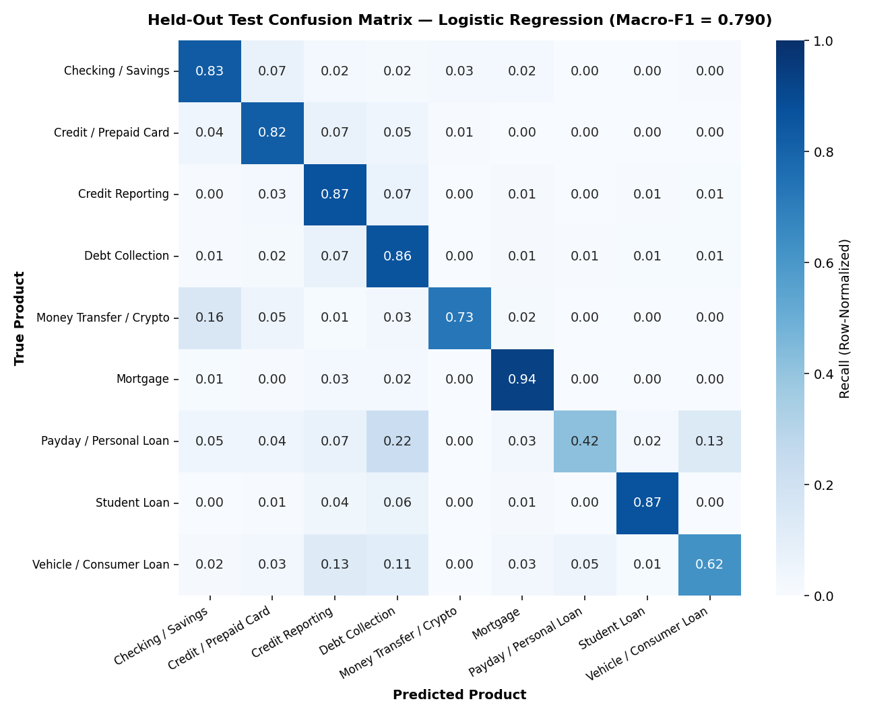
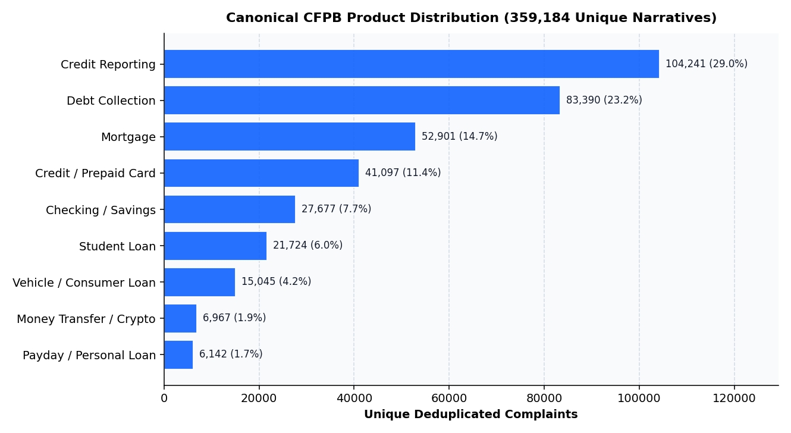
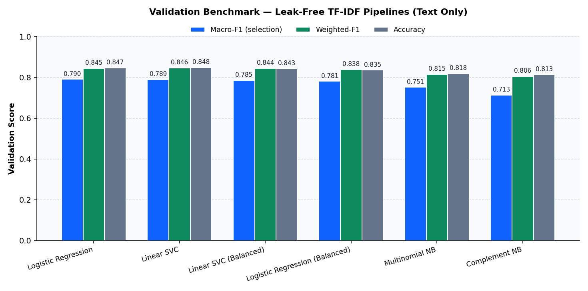
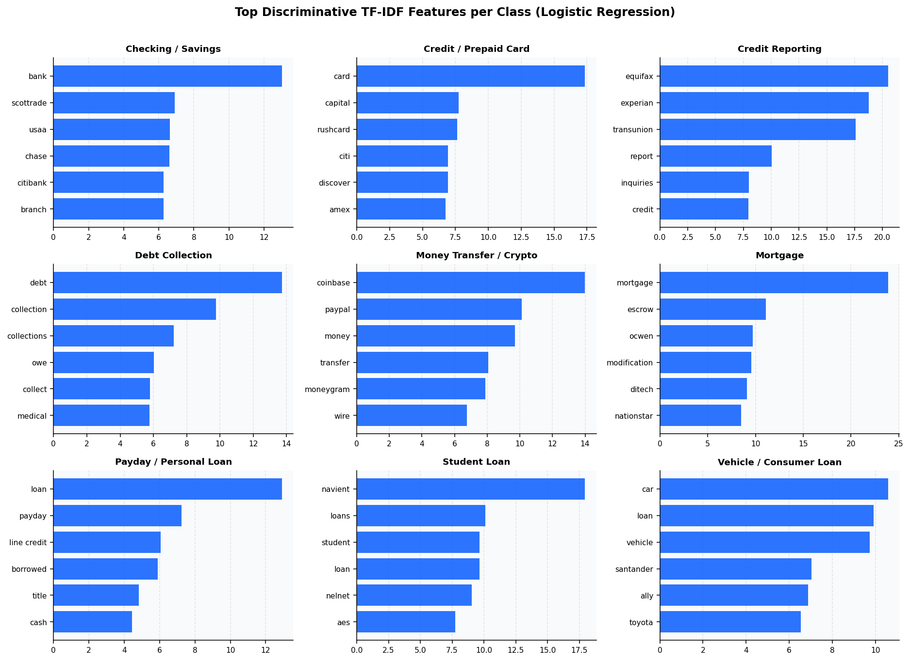

# Financial Consumer Complaints NLP Classification (Leakage-Free)

[](https://www.python.org/)
[](https://scikit-learn.org/)
[](https://www.consumerfinance.gov/data-research/consumer-complaints/)
[](LICENSE)

Multi-class NLP classification of **359,184 unique CFPB financial consumer complaints** into **9 canonical financial product categories** using **strictly leakage-free `scikit-learn` TF-IDF Pipelines**, reproducible benchmarking, feature interpretability, and a modular Python CLI for training and inference.



---

## Highlights & Methodological Rigor

Many public tutorials on the CFPB complaint dataset report artificially inflated ~99% accuracy due to subtle data and target leakage. This project is engineered specifically to eliminate every source of leakage:

1. **Zero Target Leakage (Text Only)**: Predicts `Product` **exclusively** from free-text `Consumer complaint narrative`—completely excluding correlated metadata (`Sub-product`, `Issue`, `Sub-issue`, `Company`).
2. **Zero Data Leakage (`Pipeline` + 3-Way Stratified Split)**: Splits deduplicated complaints into **70% Train (251,428) / 15% Validation (53,878) / 15% Test (53,878)** before any fitting. `ComplaintTextCleaner` and `TfidfVectorizer` are encapsulated inside `sklearn.pipeline.Pipeline`, model selection happens strictly on **Validation Macro-F1**, and the held-out **Test** split is evaluated **once**.
3. **Zero Duplicate Template Leakage**: Text normalization (stripping CFPB `XXXX` redaction masks, redacted dates `XX/XX/YYYY`, curly-braced dollar tokens, digits, and punctuation) runs before deduplication, removing **21,719 exact template duplicates** and **2,365 cross-label collisions** so identical dispute letters never appear in both train and test.
4. **CFPB Historical Taxonomy Consolidation (18 → 9 Classes)**: In April 2017 the CFPB renamed several product labels (e.g., `Credit reporting` → `Credit reporting, credit repair services, or other personal consumer reports`). Consolidating pre-2017 and post-2017 aliases eliminates temporal label drift and removes the deprecated 292-row `Other financial service` catch-all.

---

## Repository Structure

```text
financial-complaints-nlp/
├── complaints_nlp/
│   ├── __init__.py
│   ├── config.py                  # Paths, column constants, and optional .env loader
│   ├── taxonomy.py                # CFPB 18 -> 9 canonical product mapping
│   ├── preprocessing.py           # Idempotent CFPB regex cleaner, ComplaintTextCleaner, leak-free deduplicator
│   ├── modeling.py                # 6-model TF-IDF Pipeline benchmark, train-only SVC calibration, joblib I/O, plotting
│   └── cli.py                     # CLI (`train` & `predict` for single text or batch CSV)
├── notebooks/
│   └── financial_complaints_eda_and_modeling.ipynb  # Clean reproducible notebook (0 embedded outputs)
├── tests/
│   ├── test_preprocessing.py      # Unit tests for CFPB mask cleaning, taxonomy, deduplication & collisions
│   └── test_pipeline_cli.py       # Offline synthetic-data tests for pipelines, plots, joblib I/O & CLI (no CSV needed)
├── docs/assets/                   # Full-dataset evaluation charts (distribution, benchmark, confusion matrix, top features)
├── artifacts/.gitkeep             # Local trained .joblib & JSON metrics output dir (gitignored)
├── data/.gitkeep                  # Local target dir for rows.csv (gitignored)
├── .env.example
├── LICENSE                        # MIT License
├── pyproject.toml                 # Packaging & pytest configuration
├── requirements.txt               # Clean UTF-8 core dependencies
└── requirements-dev.txt           # Optional pytest & ipykernel
```

---

## Dataset Profile & Taxonomy Consolidation

Source: **CFPB Consumer Complaint Database** (2012–2018 snapshot, 1,282,355 raw rows, 737 MB CSV):

| Pipeline Stage | Row Count | Notes |
| :--- | ---: | :--- |
| Raw CSV (`rows.csv`) | 1,282,355 | 18 columns (only `Consumer complaint narrative` & `Product` loaded) |
| Non-empty narratives | 383,564 | 29.91% of complaints contain consumer-written text (median 136 words) |
| Removed deprecated `Other financial service` | −292 | 0.08% legacy pre-2017 catch-all category |
| Removed empty after CFPB mask stripping | −4 | Narratives consisting solely of `XXXX` / redacted tokens |
| Removed cross-label exact-text collisions | −2,365 | Identical cleaned narratives assigned conflicting product labels |
| Removed exact normalized template duplicates | −21,719 | Prevents identical copy-pasted dispute letters from leaking across splits |
| **Final Deduplicated Corpus** | **359,184** | Split **251,428 Train / 53,878 Validation / 53,878 Test** (stratified) |



<details>
<summary>CFPB 18 → 9 Canonical Taxonomy Mapping (defined in <code>complaints_nlp/taxonomy.py</code>)</summary>

| Canonical Category (9 Classes) | Consolidated CFPB Raw Labels | Unique Rows |
| :--- | :--- | ---: |
| `Credit reporting & repair` | `Credit reporting` + `Credit reporting, credit repair services, or other personal consumer reports` | 104,241 |
| `Debt collection` | `Debt collection` | 83,390 |
| `Mortgage` | `Mortgage` | 52,901 |
| `Credit card or prepaid card` | `Credit card` + `Prepaid card` + `Credit card or prepaid card` | 41,097 |
| `Checking or savings account` | `Bank account or service` + `Checking or savings account` | 27,677 |
| `Student loan` | `Student loan` | 21,724 |
| `Vehicle or consumer loan` | `Consumer Loan` + `Vehicle loan or lease` | 15,045 |
| `Money transfer or virtual currency` | `Money transfers` + `Virtual currency` + `Money transfer, virtual currency, or money service` | 6,967 |
| `Payday, title, or personal loan` | `Payday loan` + `Payday loan, title loan, or personal loan` | 6,142 |

</details>

---

## Model Benchmark & Held-Out Test Results

All 6 candidate pipelines share the same leak-free TF-IDF representation fitted strictly on the **251,428 Train** split (`ngram_range=(1, 2)`, `max_features=50,000`, `min_df=5`, `max_df=0.95`, `sublinear_tf=True`, English stop words).

### Validation Split Benchmark (53,878 Complaints — Model Selection by Macro-F1)

| Model | Val Macro-F1 | Val Weighted-F1 | Val Accuracy | Fit Time (CPU) |
| :--- | :---: | :---: | :---: | :---: |
| **Logistic Regression (`C=2.0`, `lbfgs`)** *(Selected)* | **0.7903** | 0.8450 | 0.8466 | 111.5 s |
| `LinearSVC` (`C=0.5`) | 0.7895 | **0.8462** | **0.8481** | 83.5 s |
| `LinearSVC` (`class_weight="balanced"`) | 0.7849 | 0.8440 | 0.8431 | 88.8 s |
| `Logistic Regression` (`class_weight="balanced"`) | 0.7807 | 0.8379 | 0.8353 | 106.7 s |
| `MultinomialNB` (`alpha=0.2`) | 0.7512 | 0.8151 | 0.8180 | 55.9 s |
| `ComplementNB` (`alpha=0.2`) | 0.7132 | 0.8058 | 0.8131 | 55.1 s |



> **Why unweighted `Logistic Regression` outperformed `class_weight="balanced"` on Macro-F1**: Heavy inverse-frequency class weights boosted minority-class recall at the expense of a sharper precision drop on overlapping classes (`Payday / Personal Loan` vs. `Debt Collection`), lowering overall Macro-F1. Unweighted `Logistic Regression` also provides native calibrated class probabilities (`predict_proba`) and converges cleanly without warnings.

### Final Held-Out Test Evaluation (`Logistic Regression`, 53,878 Unseen Complaints)

- **Macro-F1**: **0.7904** *(matches Validation `0.7903` — confirming zero overfitting / leakage)*
- **Weighted-F1**: **0.8463**
- **Accuracy**: **0.8480**

| Canonical Product Class | Precision | Recall | F1-Score | Test Support |
| :--- | :---: | :---: | :---: | ---: |
| `Mortgage` | 0.9186 | 0.9361 | **0.9273** | 7,935 |
| `Student loan` | 0.9034 | 0.8696 | **0.8862** | 3,259 |
| `Credit reporting & repair` | 0.8630 | 0.8678 | **0.8654** | 15,636 |
| `Debt collection` | 0.8251 | 0.8626 | **0.8434** | 12,509 |
| `Checking or savings account` | 0.8260 | 0.8326 | **0.8293** | 4,151 |
| `Credit card or prepaid card` | 0.8140 | 0.8211 | **0.8175** | 6,165 |
| `Money transfer or virtual currency` | 0.8170 | 0.7263 | **0.7690** | 1,045 |
| `Vehicle or consumer loan` | 0.7400 | 0.6216 | **0.6757** | 2,257 |
| `Payday, title, or personal loan` | 0.6172 | 0.4202 | **0.5000** | 921 |

### Model Interpretability & Error Analysis



- **Main confusion clusters (visible in the confusion matrix)**:
  - `Payday, title, or personal loan` (1.7% of corpus) is confused with `Debt collection` (22%) when overdue loans enter third-party collections, and with `Vehicle or consumer loan` (13%) due to shared installment/title loan terminology.
  - `Money transfer or virtual currency` overlaps with `Checking or savings account` (16%) on bank wire transfers and bank-linked payment apps.
- **Production generalization note**: The top TF-IDF weights reveal both domain terminology (`mortgage`, `escrow`, `debt`, `collection`, `payday`, `wire`) and specialized institution names (`equifax`, `navient`, `coinbase`, `santander`). For deployment across unseen financial institutions, masking organization named entities or fine-tuning a domain transformer (e.g., DeBERTa/FinBERT) is a natural next iteration.

---

## Quick Start

### 1. Clone and install dependencies

```bash
git clone https://github.com/wyde1/financial-complaints-nlp.git
cd financial-complaints-nlp

python -m venv .venv
# Linux / macOS:
source .venv/bin/activate
# Windows PowerShell:
# .venv\Scripts\Activate.ps1

pip install -r requirements.txt
```

*(Optional)* Install development and notebook dependencies (`pytest`, `ipykernel`):

```bash
pip install -r requirements-dev.txt
```

### 2. Download the dataset (`rows.csv`)

The 737 MB dataset is excluded from Git. Download `rows.csv` from either:
- [Kaggle — Consumer Complaint Database](https://www.kaggle.com/datasets/selener/consumer-complaint-database/data)
- [CFPB Open Data Portal](https://www.consumerfinance.gov/data-research/consumer-complaints/)

Place it at `data/rows.csv` (or pass `--data-path /path/to/rows.csv` / set `DATA_PATH` in `.env`).

### 3. Train & benchmark via CLI

```bash
# Full deduplicated dataset (~359k unique complaints, ~8 min total on CPU for all 6 models)
python -m complaints_nlp.cli train \
  --data-path data/rows.csv \
  --model-out artifacts/complaint_classifier.joblib \
  --metrics-out artifacts/metrics.json \
  --plots-dir artifacts/plots

# Quick stratified subset run (~30 seconds)
python -m complaints_nlp.cli train --data-path data/rows.csv --max-rows 50000
```

### 4. Classify new complaints via CLI

```bash
# Single complaint text (human-readable)
python -m complaints_nlp.cli predict \
  --model-path artifacts/complaint_classifier.joblib \
  --text "On XX/XX/2018 my mortgage servicer misapplied my escrow payment and threatened foreclosure."

# Structured JSON output with top-3 probabilities
python -m complaints_nlp.cli predict \
  --model-path artifacts/complaint_classifier.joblib \
  --text "A third-party debt collector keeps calling my workplace about an old medical bill." \
  --top-k 3 --json

# Batch classify a CSV file
python -m complaints_nlp.cli predict \
  --model-path artifacts/complaint_classifier.joblib \
  --input-csv new_complaints.csv \
  --output-csv new_complaints_predictions.csv
```

Example JSON output:

```json
{
  "predicted_product": "Debt collection",
  "confidence": 0.9911,
  "top_predictions": [
    { "product": "Debt collection", "probability": 0.9911 },
    { "product": "Credit reporting & repair", "probability": 0.0031 },
    { "product": "Student loan", "probability": 0.0021 }
  ]
}
```

---

## Running Tests

All tests run offline on synthetic data (**no `rows.csv` or trained `.joblib` required**):

```bash
pytest -v
```

---

## Dataset Attribution & License

- **Dataset**: U.S. Consumer Financial Protection Bureau (CFPB) [Consumer Complaint Database](https://www.consumerfinance.gov/data-research/consumer-complaints/) (U.S. Government Public Domain), mirrored on [Kaggle](https://www.kaggle.com/datasets/selener/consumer-complaint-database/data).
- **Source Code**: Released under the [MIT License](LICENSE).
